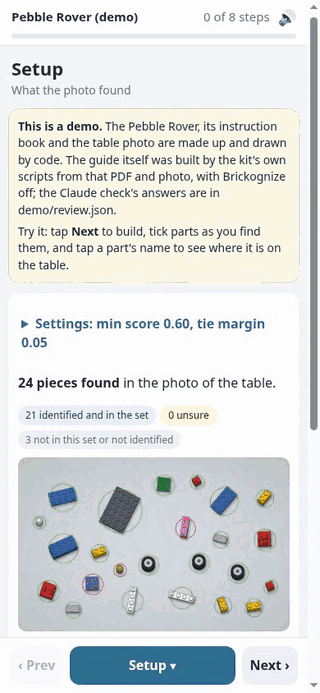
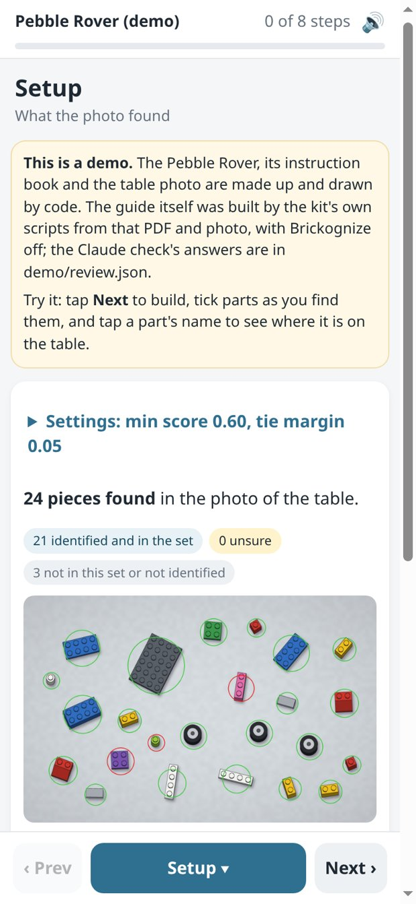
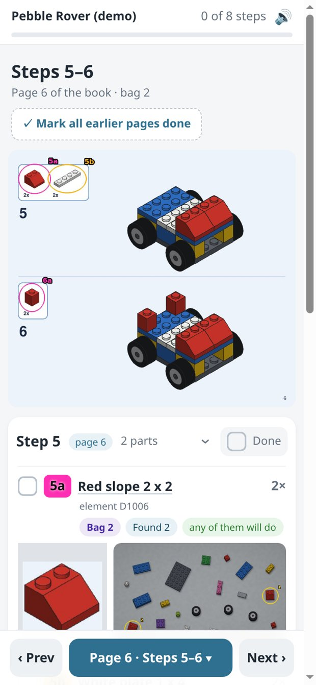
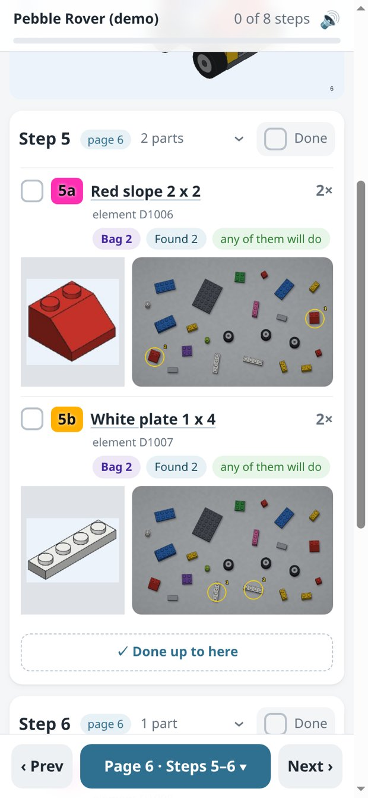
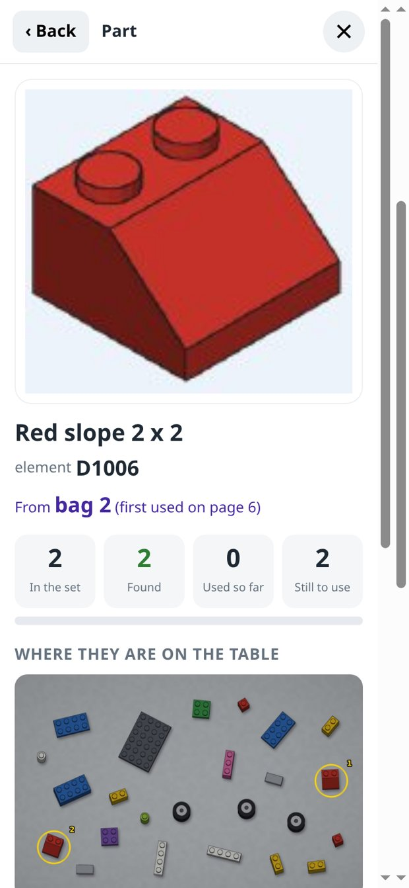
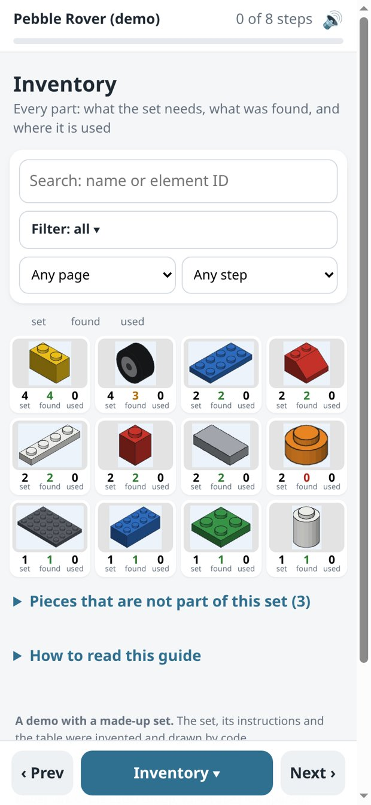
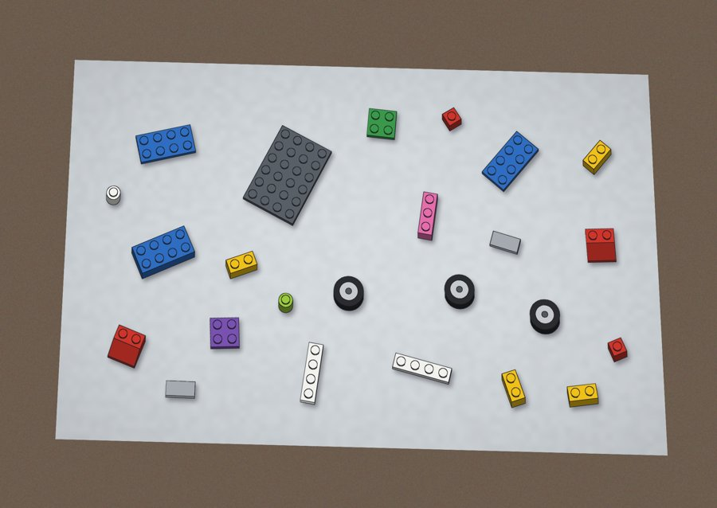
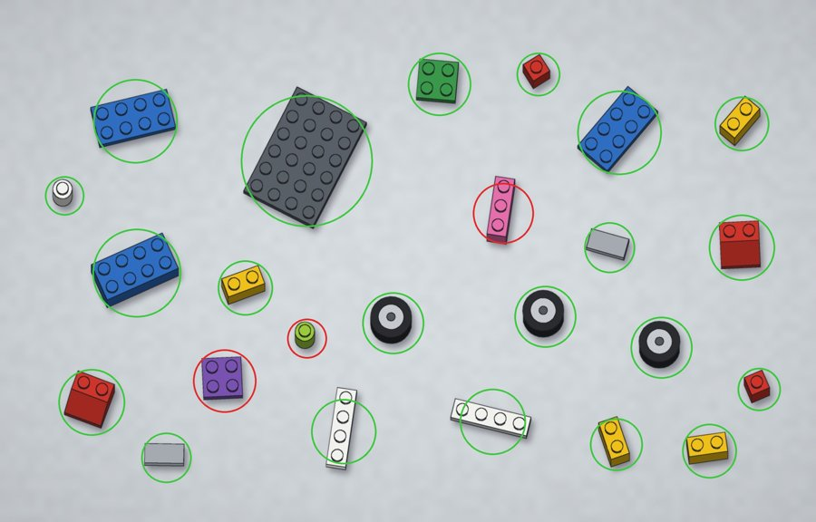
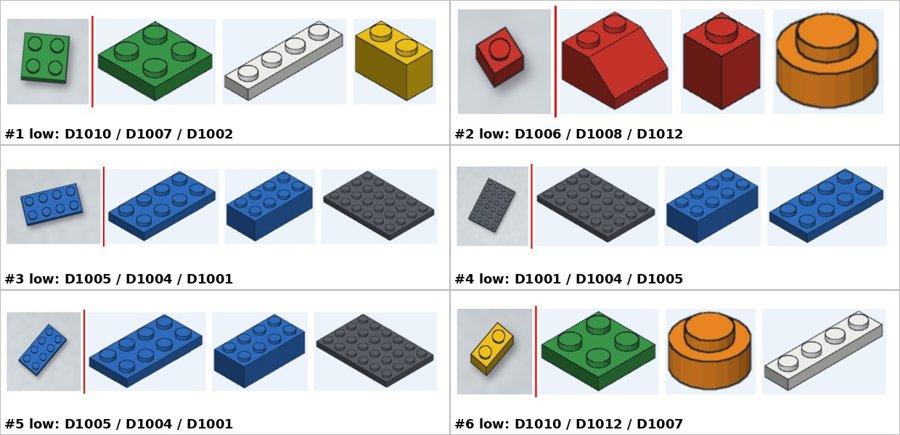

# brick-build-guide-kit

A [Claude Code](https://claude.com/claude-code) skill for building a brick set from a mixed-up
pile. You give it **your own instruction PDF** and **a photo of your pieces spread on a table**.
It makes a phone guide: each book page with its new parts labelled, an inventory of every part,
and a map of where each matching piece is on your table.

It works with LEGO® instruction PDFs, and with any instruction book laid out the same way:
a parts box per step with "4x" counts, and a parts list with element IDs at the back.



**[Try the live demo](https://benjaminmholden.com/writing/lego-guide/)** at the end of the post
about how it was built: a made-up set, the *Pebble Rover*, drawn entirely by code and run
through the real pipeline. `python demo/make_demo.py` builds the same demo on your computer.

| Setup | A book page | A step | A part | Inventory |
|---|---|---|---|---|
|  |  |  |  |  |

## What the guide does

- **Book pages, a couple at a time.** Each page of your book with every new part ringed and
  labelled **step + letter** (5a, 5b: left to right in step 5's parts box), so the labels match
  the book's own step numbers. Each part shows its **element ID** from the parts list and the
  **bag** it comes from.
- **Where it is on the table.** A map of your table with every matching piece ringed: any of
  them will do.
- **Inventory.** Every part in the set: how many the set needs, how many were found, how many
  you have used. Search, filter by found / some / none, by page and by step. Tap a part for
  its table map and every step that uses it.
- **Progress on the phone.** Tick parts and steps; finished steps fold away and the guide moves
  to the next page. Ticks are kept in the browser. No account, no server.
  Each part has "Look it up" links to Rebrickable and BrickLink; those open outside sites
  (with the element ID in the address) only when you tap them.
- **Count-only view.** With Brickognize on, a count of every piece it named, set or no set.

## How it works

Scripts do the bulk; Claude checks only what they are unsure of.

| | |
|---|---|
|  | **1. The photo.** One overhead photo of the whole table. The script finds the tabletop (the most common colour in the middle, a straight line fitted to each edge), flattens it, and finds every piece against the table colour. If the outline is off, a drag-the-corners page fixes it. |
|  | **2. Naming the pieces.** With Brickognize off (the default), every piece goes to the Claude check. With it on, Brickognize names each piece; a result under **0.60**, a near tie, or a part that is not in your parts list goes to the check. Claude also picks out big pieces by eye (scripts struggle with touching plates in glare) and takes one look over the whole table for misses. |
|  | **3. The Claude check.** Sheets of crops beside the parts-list drawings of their best candidates. Claude's answers go in one file, `review.json`, which the scripts apply. |

The instruction PDF is read from its own text layer: count labels ("4x") with an element ID
under each are the parts list; the flat box around a step's counts is its parts box; big
numbers that only count up are step numbers. Each step drawing is matched to a parts-list
drawing by picture, and no part is used more often than the parts list says.

Close-ups are optional: each is lined up with the overhead photo (matching features, then a
check that it really looks the same there), and pieces it covers get sharper crops. Where
pieces touch, Claude points at each one and the scripts crop and name it.

Pieces are identified once. A new photo every few pages reuses the earlier answers for pieces
that have not moved, so nothing is sent or checked twice.

## Install

You need [Claude Code](https://claude.com/claude-code), Python 3.9 or newer, and poppler
(`pdftoppm`, `pdftotext`): `apt install poppler-utils` or `brew install poppler`.

```bash
git clone https://github.com/benjamin-m-holden/brick-build-guide-kit.git
cp -r brick-build-guide-kit/skill/brick-build-guide ~/.claude/skills/
```

Then, in Claude Code: *"Here is my instruction PDF and a photo of my pieces: make me a build
guide."* Claude sets up a Python environment in a work folder, asks whether you want
Brickognize, and walks through the steps in [`SKILL.md`](skill/brick-build-guide/SKILL.md).
The scripts can also be run by hand; each one's `--help` says what it does.

**Photo tips:** a light, plain surface; pieces spread so none touch; no glare; the whole table
from straight above with all four corners in the picture. Close-ups of parts of the table,
taken right after, sharpen small pieces. Retake the photos every few pages.

## Brickognize: off unless you turn it on

[Brickognize](https://brickognize.com) is a free outside service that names bricks from a
picture. It is not part of this kit, and the kit works without it.

- **Off by default.** Claude asks before turning it on.
- **Its terms let it keep the pictures you send, including to train its models.** Turn it
  on only if you are fine with that.
- **Only tight crops of single pieces are sent**, never a whole photo: crops of the pieces on
  your table, with other pieces painted out; the parts-list drawings from your PDF, so each
  element gets a part number; and step drawings the picture match was unsure of. Each crop is capped in size (600 px by default).
- **Each crop is sent once** (cached by MD5), and each send is one line in
  `brickognize/sent.log`.
- `identify.py` is the **only code in the kit that uses the network**.
- If it errors, refuses, or starts charging, sending stops and Claude checks the rest. The kit
  is built to keep working without it.

## Settings

`config.json` in your work folder (from [`config.example.json`](skill/brick-build-guide/config.example.json)):

| Setting | Default | What it does |
|---|---|---|
| `brickognize.enabled` | `false` | Send crops to Brickognize |
| `brickognize.max_side_px` | `600` | Size cap for anything sent |
| `review.min_score` | `0.60` | Below this, Claude checks the piece |
| `review.tie_margin` | `0.05` | Top two answers this close: Claude checks |
| `review.drawing_gap` | `0.30` | Step drawings matched by a smaller margin are checked |

Photo quality and unusual pieces change what works: raise `min_score` for blurry photos, glare
or a busy table; lower it for sharp photos on a plain light background. The guide's Setup page
shows the values in use.

## Keep your guide to yourself

The guide shows pages of your instruction book, and those belong to their publisher. It is
for your own use: open it on your computer or serve it on your home network. Do not publish
it. This repository contains **no** instruction pages, part renders or set photos from any
real set; the demo is drawn by code.

## Limits

- The PDF needs a text layer and a parts list with element IDs. A scanned book will not work.
- Close-ups help only when taken at the same time as the overhead photo; one taken after
  pieces moved does not line up and is skipped.
- Pieces that touch may be counted as one; a dark or patterned table hides dark pieces.
- Identification can be wrong. The book is always right.
- Made for Claude Code. A claude.ai version is out of scope.

## Repository

```
skill/brick-build-guide/   the skill: SKILL.md, scripts/, site/ (page CSS, JS, crop fixer), config
demo/                      the Pebble Rover: model, renderer, make_demo.py, review.json
tests/                     builds the demo through the pipeline and checks it against what was drawn
docs/                      the pictures in this README (all from the demo)
```

`python -m pytest tests` runs the whole pipeline on the demo (needs `demo/requirements.txt` too).

What we used (November 2026): Claude Code on a Claude subscription, Python 3.11, OpenCV 5.0,
NumPy 2.4, Pillow 13, poppler 22.12, reportlab 5.1.

## License and trademarks

MIT, see [LICENSE](LICENSE). Third-party services and libraries: [NOTICE.md](NOTICE.md).

LEGO® is a trademark of the LEGO Group, which does not sponsor, authorize or endorse this project.
